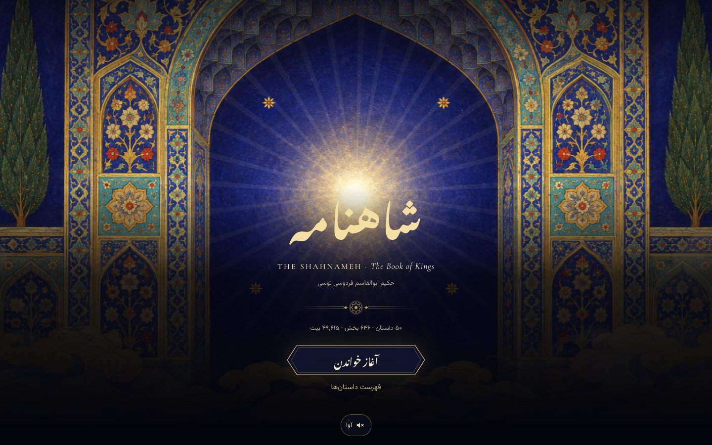
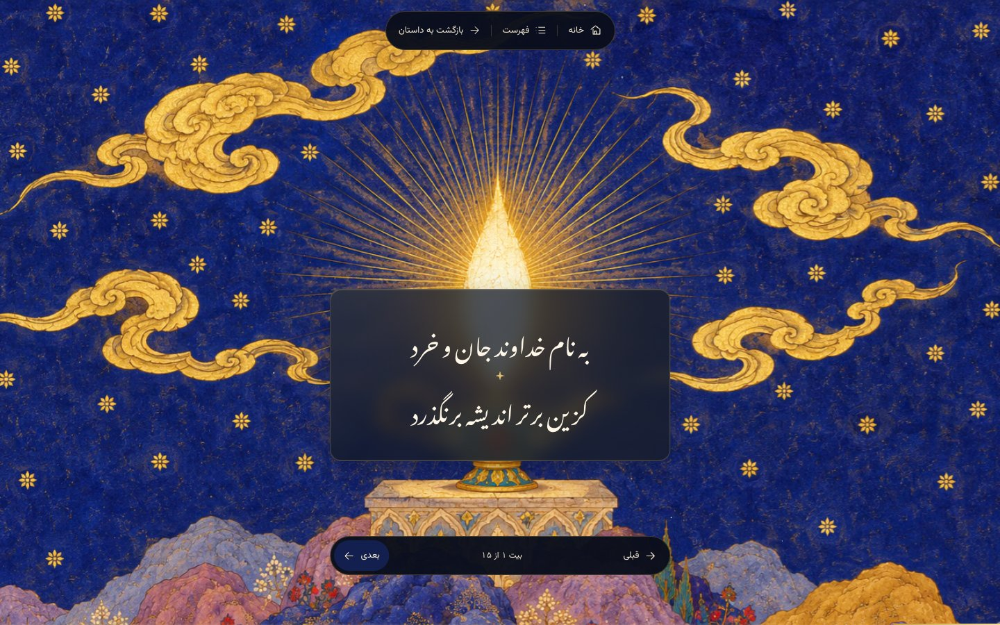
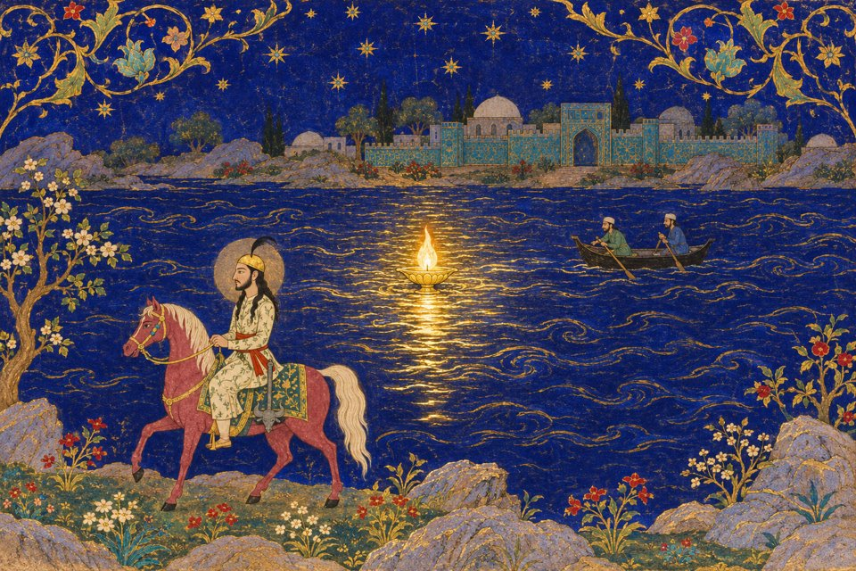

<p align="center">
  
</p>

<h1 align="center">شاهنامه‌ی دیدنی<br>Visual Shahnameh</h1>

<p align="center"><strong>A living, illuminated edition of the world's great Persian epic, one couplet at a time.</strong></p>
<p align="center"><a href="https://shahnameh.world">Read the Shahnameh · شاهنامه بخوانید</a> · <a href="#contribute">Contribute</a> · <a href="CONTRIBUTING.md">Contributor guide</a></p>

<div dir="rtl" align="center">

خرد چشم جانست چون بنگری<br>
تو بی‌چشم شادان جهان نسپری

</div>



## Why we are building this

We want every one of Ferdowsi's 49,615 couplets to have a place you can step
inside. Persian miniature painting, Nastaliq poetry and a generative score
turn the book into a journey through light, landscape and story. The ambition
is the complete Shahnameh: fifty chapters, made carefully enough that the art
serves the words.

<div dir="rtl">

شاهنامه میراثی برای خواندن و دوباره زیستن است. می‌خواهیم راهی بسازیم تا هر بیت،
با نگارگری و موسیقی، دری به جهان فردوسی باز کند؛ برای فارسی‌زبانان امروز و
نسل‌هایی که هنوز این داستان‌ها را نشنیده‌اند.

</div>

The reader is Persian and right-to-left. Scroll slowly into the paintings, or
move between couplets with the arrow keys and on-screen controls. Your last
reading position stays in your browser. Sound is synthesized locally, and the
site respects reduced-motion preferences. No account is needed.



## Inside the paintings

Original generated illustrations follow a Timurid–Safavid miniature direction:
mineral blues, shell gold, stacked landscapes and a luminous centre that opens
into the next scene. Prompts and character sheets live beside the source so
contributors can keep the story visually coherent.

| The opening lamp | Fereydun at the Arvand |
| --- | --- |
|  |  |

<div dir="rtl" align="center">

توانا بود هر که دانا بود<br>
ز دانش دل پیر برنا بود

</div>

## Run locally

Use Node.js 24 and pnpm **12.16.1**, pinned in `package.json`.

```sh
git clone https://github.com/farzinnasiri/visual-shahnameh.git
cd visual-shahnameh
make install
pnpm dev
```

Open `http://localhost:5173`. Optimized AVIF paintings are included, so a
fresh clone can read the completed chapters immediately. To generate or check
new sections, run `pnpm setup`, install Chromium with
`pnpm exec playwright-core install chromium`, and install `ffmpeg`.

```sh
pnpm status             # completed sections, claims and the next section
pnpm check 02.01        # text, paintings, screenshots and the full score
pnpm build              # typecheck and production build
```

## Contribute

Fork the repository, create a branch, and open a pull request to `main`.
Farzin reviews and merges contributions. You do not need Cloudflare access.

Image generation requires **your own Codex account and Codex app**. Generate
the illustrations there, then add the reviewed files to your checkout. Visual
Shahnameh does not generate images or provide access to anyone's accounts.

You can copy this prompt into your Codex app. Replace **X** with any positive
whole number of chapters. A chapter can contain many sections, so a large X
can mean a substantial amount of artwork and music.

```text
Build the next X chapters of Visual Shahnameh in this checkout.
Read AGENTS.md (Orchestrator) and docs/BUILDER_BRIEF.md first and follow them.
Use pnpm status and scripts/next_sections.mjs --chapters X to find the next
unbuilt chapters. Plan and claim every section before starting builders.
Keep consecutive story sections together. Generate all illustrations in my own
Codex app using my own Codex account. Visual Shahnameh is a reader, not an
image-generation service.
Ask before launching other agents unless I have already authorized them.
Generate and personally review the paintings, preserve the source text exactly,
compose the scores, and run the full section checks. Inspect both desktop and
phone contact sheets. Write each section report and a batch report, stating
anything that failed or was not verified. Release unfinished claims.
Do not overwrite existing paintings, change shared engine code, deploy, or
commit. Stop with a reviewable result and a list of the sections completed.
```

The prompt starts the process; a finished contribution still needs human
judgment about the images, Persian text, transitions and sound. The
[contributor guide](CONTRIBUTING.md) explains the quality gates and the
[pull-request template](.github/pull_request_template.md) records what was
actually verified. UI, accessibility and engine fixes are welcome too.

## Chapter checklist

As of 2026-11-05, chapters 01–07 are complete through **07.18, درگذشتن فریدون**.
The app includes **40 of 646 sections** and **1,941 of 49,615 couplets**, with paintings and generative music.
Next: **08.01, پادشاهی منوچهر**. Unchecked chapters remain to be illustrated and scored.

The source heading 07.13 has no couplets; it is included as a title-only section.

- [x] 01 · آغاز کتاب (11/11 sections)
- [x] 02 · کیومرس (1/1 sections)
- [x] 03 · هوشنگ (1/1 sections)
- [x] 04 · تهمورس (1/1 sections)
- [x] 05 · جمشید (2/2 sections)
- [x] 06 · ضحاک (6/6 sections)
- [x] 07 · فریدون (18/18 sections)
- [ ] 08 · منوچهر (0/1 sections)
- [ ] 09 · زال و رودابه (0/31 sections)
- [ ] 10 · نوذر (0/6 sections)
- [ ] 11 · افراسیاب (0/6 sections)
- [ ] 12 · زوتهماسپ (0/1 sections)
- [ ] 13 · گرشاسپ (0/6 sections)
- [ ] 14 · کیقباد (0/4 sections)
- [ ] 15 · کی کاووس (0/4 sections)
- [ ] 16 · هفتخوان رستم (0/34 sections)
- [ ] 17 · رستم و سهراب (0/19 sections)
- [ ] 18 · سیاوش (0/55 sections)
- [ ] 19 · پادشاهی کیخسرو (0/19 sections)
- [ ] 20 · داستان کاموس کشانی (0/22 sections)
- [ ] 21 · داستان خاقان چین (0/13 sections)
- [ ] 22 · داستان اکوان دیو (0/4 sections)
- [ ] 23 · داستان بیژن با منیژه (0/17 sections)
- [ ] 24 · داستان دورازده رخ (0/24 sections)
- [ ] 25 · جنگ بزرگ کیخسرو با افراسیاب (0/34 sections)
- [ ] 26 · پادشاهی لهراسپ (0/2 sections)
- [ ] 27 · پادشاهی گشتاسپ (0/16 sections)
- [ ] 28 · هفتخوان اسفندیار (0/14 sections)
- [ ] 29 · داستان رستم و اسفندیار (0/22 sections)
- [ ] 30 · داستان رستم و شغاد (0/5 sections)
- [ ] 31 · پادشاهی بهمن اسفندیار (0/26 sections)
- [ ] 32 · پادشاهی اسکندر (0/11 sections)
- [ ] 33 · پادشاهی اشکانیان (0/6 sections)
- [ ] 34 · داستان هفتواد و سرگذشت کرم (0/5 sections)
- [ ] 35 · پادشاهی ساسانیان (0/22 sections)
- [ ] 36 · پادشاهی یزدگرد بزه (0/9 sections)
- [ ] 37 · پادشاهی بهرام گور (0/21 sections)
- [ ] 38 · پادشاهی یزدگرد پسر بهرام گور (0/2 sections)
- [ ] 39 · پادشاهی پیروز (0/1 sections)
- [ ] 40 · پادشاهی بلاش (0/1 sections)
- [ ] 41 · پادشاهی قباد (0/9 sections)
- [ ] 42 · پادشاهی انوشیروان (0/37 sections)
- [ ] 43 · پادشاهی هرمزد (0/18 sections)
- [ ] 44 · پادشاهی خسرو پرویز (0/40 sections)
- [ ] 45 · داستان خسرو و شیرین (0/13 sections)
- [ ] 46 · پادشاهی قباد مشهور بشیرویه (0/6 sections)
- [ ] 47 · پادشاهی اردشیر شیروی (0/3 sections)
- [ ] 48 · پادشاهی پوراندخت (0/1 sections)
- [ ] 49 · پادشاهی آزرم دخت (0/2 sections)
- [ ] 50 · پادشاهی یزدگرد (0/14 sections)

## Deployment and security

[shahnameh.world](https://shahnameh.world) runs entirely on Cloudflare Workers
Static Assets and its CDN. GitHub Actions checks pull requests without
production credentials. An owner push or merge to `main` checks and builds the
site, then deploys that exact build in a separate job. `develop`, if used,
runs checks only. See [DEPLOY.md](DEPLOY.md) for the token and environment setup.

Only **@farzinnasiri** may update `main` or `develop`. Contributors submit PRs;
production credentials belong only in the restricted `production` environment,
never in source, prompts, reports or browser-facing `VITE_` variables.

See [SECURITY.md](SECURITY.md) for reporting a vulnerability.

## Find your way around

| Where | What |
| --- | --- |
| [DESIGN.md](DESIGN.md) | Art direction, typography, motion and architecture |
| [AGENTS.md](AGENTS.md) | Section planning, claims and builder responsibilities |
| [art/STYLE.md](art/STYLE.md) | Painting rules and prompt template |
| [art/characters/](art/characters/) | Recurring character sheets |
| [docs/BUILDER_BRIEF.md](docs/BUILDER_BRIEF.md) | Complete builder checklist |
| [reports/](reports/) | Section results and known limitations |
| [sound/SOUND.md](sound/SOUND.md) | Generative music and sound criteria |
| [text/](text/) | The complete source text and table of contents |
| [DEPLOY.md](DEPLOY.md) | Cloudflare hosting, CI and DNS |

Source text: takbook.com PDF edition, after Fereydoun Joneydi's 1354 edition
([source PDF](source/shahnameh-ferdowsi.pdf)). Couplets are preserved verbatim.
Illustrations are generated for this project; documentation previews are
smaller JPEG copies of the shipped AVIF paintings. Original generated PNGs,
local credentials and generated check output are excluded from Git.
